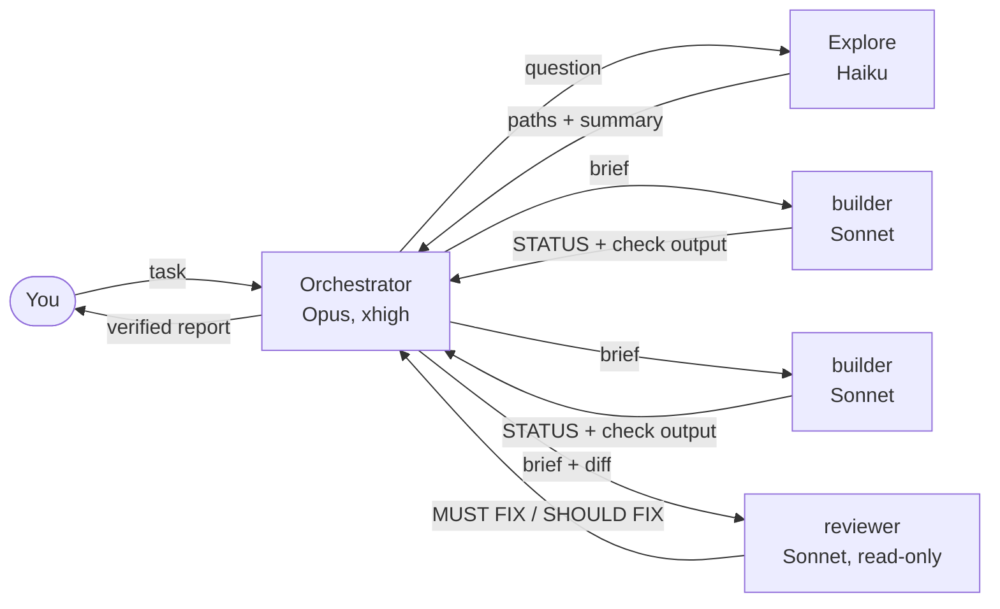

# omega

An orchestrator mode for [Claude Code](https://code.claude.com). Run `claude-omega` instead of `claude` and the session runs on Opus at `xhigh` effort as a lead engineer. It plans, writes self-contained briefs, sends implementation to cheaper worker subagents in parallel, re-runs every check itself, and has a fresh read-only reviewer check the diff before it reports back. Plain `claude` stays as it was, for quick tasks.

## Why use it

Claude Code already plans and edits well on its own. Omega changes how a large, multi-part task gets done:

- **Parallel work.** Independent pieces go to separate builders at the same time, instead of one long serial session.
- **Opus tokens only where Opus matters.** Implementation runs on Sonnet and searches on Haiku, while Opus spends its tokens on planning, briefs and verification. Anthropic measured Opus orchestrating Sonnet subagents at about the same quality as Opus alone, at lower cost, on a task larger than one context window ([source](https://platform.claude.com/docs/en/about-claude/models/optimizing-for-cost-and-intelligence)).
- **Claims get checked.** Every worker reports the exact command it ran. The orchestrator re-runs it before telling you anything, and a reviewer that never saw the reasoning reads the diff.
- **A lean main context.** Test logs, wide searches and file dumps stay in the workers' contexts; the orchestrator keeps the conclusions.

**When not to use it:** single-file fixes, quick questions, and work where each step depends on the last. There the extra agents add cost and latency without improving the result, so use plain `claude`.

## Install

Paste this into Claude Code:

```text
Set up Omega for me from https://github.com/bakirgdev/omega: clone it to a temporary directory, read SETUP.md there, and follow it.
```

The agent checks your Claude Code version and config, then asks four questions: user or project scope, orchestrator model and effort, worker models, and optional parts. It copies the files from the clone, backs up anything it would overwrite, and asks before touching your shell rc. Finally it verifies that Claude Code loads everything. It never edits `settings.json`.

Requires Claude Code 2.1.271 or later, and zsh or bash for the launchers.

## What gets installed

This repo's `.claude/` directory holds the files that get installed, and doubles as a working project-level install of the agents and `/wrap`.

| File | Installed to | Role |
|---|---|---|
| `.claude/omega/orchestrator.md` | `~/.claude/omega/` | Orchestration rules, appended to the default system prompt by the launchers |
| `.claude/omega/omega.sh` | `~/.claude/omega/`, sourced from your rc | `claude-omega` (auto mode) and `claude-omega-dsp` (`--dangerously-skip-permissions`), both Opus at `xhigh` |
| `.claude/agents/builder.md` | user or project `.claude/agents/` | Implements one brief, runs its Done-when check, reports `PASS`, `FAIL` or `BLOCKED` with the command output (Sonnet) |
| `.claude/agents/reviewer.md` | user or project `.claude/agents/` | Read-only; checks a diff against its brief and reports `MUST FIX` and `SHOULD FIX` with `file:line` (Sonnet) |
| `.claude/agents/Explore.md` | user or project `.claude/agents/` | Optional; replaces the built-in Explore so searches run on Haiku |
| `.claude/skills/wrap/SKILL.md` | user or project `.claude/skills/` | Optional `/wrap`: updates stale docs from the session's diff, then proposes fixes to agents, skills and CLAUDE.md; applies nothing without approval |

## How a session runs



1. **Decide.** The orchestrator delegates only when it pays: independent pieces that can run in parallel, large changes that would flood its context, noisy output (test suites, logs, wide searches), and independent review. Dependent single-thread work and small edits it does itself.
2. **Brief.** Each brief has a goal, context (paths, decisions, rules CLAUDE.md doesn't already state), a file scope, a runnable Done-when check, and a report format. Parallel builders never share a file.
3. **Verify.** The orchestrator runs every Done-when check itself. A failure goes back to the same builder through `SendMessage` with the output, at most twice, before it fixes the issue itself or re-plans.
4. **Review.** For non-trivial changes, `reviewer` gets the brief and the diff but not the orchestrator's reasoning, and reports correctness gaps only. `MUST FIX` findings go back to a builder.
5. **Report.** What changed, which checks ran with what result, and open risks.

For jobs with more than about eight similar independent items, the orchestrator suggests a [dynamic workflow](https://code.claude.com/docs/en/workflows) and waits for you to opt in.

## Use

```sh
claude-omega       # orchestrated session, auto permission mode
claude-omega-dsp   # same, no permission checks: only in a sandbox
claude             # unchanged, for quick tasks
```

Arguments pass through, so `claude-omega -c` continues the last session. Inside a session, `/agents` lists the workers and `/wrap` closes a session out.

Give it a goal and a check it can run. A real run on a small Python repo:

```text
> Two independent changes: add mul(a, b) to calc.py with a unittest in test_calc.py, and
  add sub(a, b) to a new sub.py with a unittest in test_sub.py. Done when
  python3 -m unittest discover passes.
```

The orchestrator sent both changes to two builders in parallel. Each reported `STATUS: PASS` with its test output. The orchestrator then read the diff and re-ran the full test discovery itself (3 tests, OK) and sent the diff to `reviewer`, which found nothing to fix. Its final report listed the changes, the checks it ran, and the edge cases it skipped. Total cost was $0.53. The example is deliberately tiny; the payoff grows with tasks that have more independent parts.

## Design decisions

Each choice below departs from the obvious version of this setup for a documented reason.

- **Appended prompt, not `claude --agent orchestrator`.** Running a custom agent as the main session replaces Claude Code's entire default system prompt with the agent body ([subagents docs](https://code.claude.com/docs/en/sub-agents#invoke-subagents-explicitly)), dropping the built-in guidance on tools, scoping, safety and verification. `--append-system-prompt-file` keeps all of it and adds the orchestration rules. Model and effort come from the `--model` and `--effort` flags, which apply to that session only. An `/omega` skill was the other candidate, but after compaction Claude Code drops the oldest invoked skills first, and the orchestrator's would be the oldest.
- **Orchestrator rules are user-level only.** The launchers read `~/.claude/omega/orchestrator.md` and never a repo's copy, because a cloned repo's file would reach the system prompt before Claude Code's workspace trust check. Scope choice covers the agents and `/wrap`.
- **Builder on Sonnet, not Haiku.** Anthropic says Sonnet and Opus remain the better choices for complex agentic coding and suits Haiku to narrowly scoped tasks. Its published cost guidance found Opus with Sonnet subagents scoring about the same as Opus alone at lower cost, while Haiku subagents traded accuracy for savings ([choosing a model](https://platform.claude.com/docs/en/about-claude/models/choosing-a-model), [cost and intelligence](https://platform.claude.com/docs/en/about-claude/models/optimizing-for-cost-and-intelligence)). Haiku remains a setup option.
- **Explore on Haiku.** The built-in Explore runs on the session's model, so under Omega every search would run on Opus. An agent named `Explore` overrides it and keeps its own `model` ([docs](https://code.claude.com/docs/en/sub-agents#built-in-subagents)). It sets `omitClaudeMd: true` to stay as lean as the built-in, which also skips CLAUDE.md.
- **No global environment variables.** `CLAUDE_CODE_SUBAGENT_MODEL` only fills in for agents without a `model` field, so setting it would quietly move `general-purpose` and others to that model in every session. A global `CLAUDE_AUTOCOMPACT_PCT_OVERRIDE` would change compaction everywhere too. To compact Omega sessions earlier, add `--autocompact 400000` (or another value from 100000 up) in `omega.sh`.
- **Reviewer reports correctness only.** A reviewer asked to find problems always finds some, and fixing every style note adds churn ([best practices](https://code.claude.com/docs/en/best-practices)). The orchestrator weighs `SHOULD FIX` findings on their merits.
- **Delegation is conditional.** Subagents pay off for parallel work, noisy output and independent review; a dependent chain that fits in one context is done better and cheaper in place ([best practices](https://code.claude.com/docs/en/best-practices), [cost and intelligence](https://platform.claude.com/docs/en/about-claude/models/optimizing-for-cost-and-intelligence)).
- **No worktree isolation.** Subagent worktrees branch from the default branch unless configured otherwise, so builders would not see uncommitted work ([worktrees](https://code.claude.com/docs/en/worktrees)). Disjoint file scopes, plus sequencing for overlaps, avoid that.
- **Files ship pre-made, not embedded in the prompt.** One versioned source of truth, readable and diffable, that setup copies. The install prompt holds instructions only, so it cannot drift from the files.
- **Not a plugin.** Plugin agents are namespaced (`omega:builder`), the Explore override is documented only for user and project agents, and a plugin can neither install the launchers nor ask setup questions.

## Customize

Edit the installed files directly:

- **Worker model:** the `model:` line in `builder.md` or `reviewer.md` (`haiku`, `sonnet`, `opus`, `fable`, or a full model ID).
- **Orchestrator model or effort:** `--model` and `--effort` in `~/.claude/omega/omega.sh`.
- **Orchestration rules:** `~/.claude/omega/orchestrator.md`. `/wrap` proposes edits here when a session shows a rule went wrong.

Settings that silently override Omega, which setup reports if found: `CLAUDE_CODE_SUBAGENT_MODEL_FORCE` (subagents ignore their `model`), `CLAUDE_CODE_EFFORT_LEVEL` (beats `--effort`), and `CLAUDE_CODE_DISABLE_EXPLORE_PLAN_AGENTS`.

## Uninstall

```sh
rm -r ~/.claude/omega ~/.claude/skills/wrap
rm ~/.claude/agents/builder.md ~/.claude/agents/reviewer.md ~/.claude/agents/Explore.md
```

For a project install, delete the same agent and skill files under the project's `.claude/` instead. Then remove the `source "$HOME/.claude/omega/omega.sh"` line from your rc file and restore any backups setup reported.

## Development

```sh
shfmt -d .claude/omega/omega.sh tests/launchers.test.sh
shellcheck .claude/omega/omega.sh tests/launchers.test.sh
tests/launchers.test.sh
```

The test sources `omega.sh` in zsh and bash with a stub `claude` and checks the exact arguments each launcher passes.

## License

[MIT](LICENSE)
